# srsRAN 4G Studio — Implementation Verification Report

**Project:** Roguard 5.2 — Rogue Base-Station Detection Sensor  
**Audit date:** 22 November 2026; user timezone Africa/Cairo  
**Scope:** Verification only. No production source changes, fixes, refactoring, dependency upgrades, branch changes, resets, stashes, database resets, or physical RF transmissions were performed.

## A. Executive Summary

**Studio contains a functioning native LTE laboratory, not merely a topology mockup.** During this audit, actual srsEPC, srsENB and srsUE processes completed core initialization, S1 setup and NAS attachment over ZeroMQ. Two and three eNodeBs ran simultaneously. One eNodeB also ran two and three cells, with the UE independently reporting serving PCI 6 and PCI 11 in separate controlled selection experiments. The compiled C++ broker transported, mixed and distributed FC32 samples. The mandatory PCI 1 → save PCI 2 → restart experiment passed. Native crash/restart/stop tests passed, and real native measurements reached the independent Roguard bridge implementation through authenticated replay/SSE.

**This does not establish that every advertised user workflow is complete.** The current browser requires a Roguard connection before it starts or restarts LTE. Existing native browser tests do not handle that dialog. They fail in the isolated standalone Studio configuration even though the corresponding backend/native acceptance tests pass. The connection dialog and tests/documentation need to be reconciled; this audit did not reconfigure the user's Roguard deployment to make them pass.

Material defects and limitations:

- Native CSV `is_attached` is generated from **RRC_CONNECTED**, not NAS registration. Studio overwrites its NAS-derived attachment flag with that CSV value and can resolve a serving cell from an RRC-only fixture. The UI's “NAS evidence verified” label is consequently stronger than its immediate data source warrants. Successful native attachment in this audit is separately proven by NAS logs and assigned IPv4.
- The machine snapshot advertises one eNodeB and `multi_cell_verified=false` even after a three-eNodeB experiment. It returns only one eNodeB metric. Replay retains the individual component IDs, but snapshot/latest projections do not fully represent multiple eNodeBs.
- Both CSV export paths omit `component_id`. Measurements from different eNodeBs become indistinguishable by identity in CSV, although JSON preserves the IDs.
- Serving-cell validity has no measurement-age timeout. A stale observation can remain current while a process remains alive and no fresh CSV rows arrive. Stopped/detached state is handled separately and does clear the current association.
- No completed handover, geographical propagation, coverage simulation, radio-driven mobility, independent decoded ECI/PLMN/TAC topology, structured SIB observations, or complete neighbor topology is integrated. These are additional development, not capabilities demonstrated by active I/Q paths.
- Equal-strength three-cell execution failed native attachment while all sample paths remained active. The supported three-cell baseline uses 20 dB attenuation on competing paths. General interference robustness is not established.

**Current-audit results:** 60 prepared Studio backend/broker/bridge tests passed; 8 independent Roguard bridge tests passed; TypeScript checking passed; an unchanged production-build retry passed after an initial Next.js security diagnostic. The prepared browser run finished with **6 passes and 3 failures**: all three native-start workflows timed out at the required Roguard connection dialog. All individual commands are recorded in section E and the linked evidence. The initial fresh-copy backend run had 59 passes and one missing-broker-prerequisite failure; it is not hidden by the prepared rerun.

The feature-level outcome is **7 VERIFIED WORKING within the tested scope and 6 PARTIALLY IMPLEMENTED**. No whole feature is declared absent merely because it has an incomplete edge or UI integration.

The team can treat the constrained native laboratory, broker arithmetic, configuration generation, saved design editor and basic persistence/export machinery as built. Correct attachment provenance, multi-eNodeB integration projections/export fidelity, and the browser connection/start contract require correction before claiming a fully verified end-to-end workbench.

### Repository identity and preservation

| Item | Studio repository A | Roguard repository B |
|---|---|---|
| Local path | `/mnt/disk-d/joe/Projects/srsRAN_4G` | `/mnt/disk-d/joe/Projects/rogue-bs-detection` |
| Origin | `https://github.com/RogueBS-Research/srsRAN_4G.git` | `https://github.com/RogueBS-Research/rogue-bs-detection.git` |
| Expected branch | `feat/roguard-lte-studio` | `main` |
| Actual branch | `feat/roguard-lte-studio` | **`feat/admin-command-foundation`** |
| SHA at first inspection | `1f39982641b0a952f6afb1a74b0eb36c558630a4` | `43560e3f790af3f7f4eb3b0b3faae99c30f327b8` |
| SHA subsequently observed | `e8b64044591cc247d2d5e7e0dd66a7794bd69b75` | Unchanged |
| Initial working tree | Modified `roguard-studio/frontend/next-env.d.ts` and `roguard-studio/frontend/tsconfig.json` | Clean |
| Later tree before audit outputs | Clean | Clean |

Studio HEAD advanced externally during the audit: `e8b6404` is a child of `1f39982` and contains only those two frontend file changes (5 insertions, 3 deletions). **The auditor did not commit or change the checkout.** The initial working tree therefore contained changes beyond the initial reviewed commit. The disposable copy included the then-current files; source hashes checked later were unchanged. Results are tied to that copy and its [source manifest](roguard-studio/docs/audit-evidence/2026-11-22/source-manifest.json), rather than silently attributed solely to the original SHA. No remote fetch or comparison with current remote branches was performed. Roguard findings apply to its actual feature-branch checkout, not to uninspected `main`.

### Evidence classes and locations

- **A — produced during this audit:** logs, native CSVs, selected native log excerpts, sanitized generated configurations, result JSONs, browser artifacts, exact probe scripts and environment information under [audit-evidence/2026-11-22](roguard-studio/docs/audit-evidence/2026-11-22/README.md).
- **H — historical:** pre-existing `roguard-studio/docs/*acceptance*.json`, `multicell-native-verification.json`, bridge/reliability summaries and screenshots. They are supporting historical records only. Several recorded original run directories are absent locally, so those summaries cannot substitute for current execution.
- **S — source inspection:** the actual implementation and native source, with line references below. Code presence alone is not execution proof.
- **D — documentation claims:** README and capability/measurement guides. Some are stale or inconsistent; their assertions do not determine verdicts.

All execution used a disposable copy at `/tmp/studio-audit-20261122/work/srsRAN_4G/roguard-studio`. Temporary service databases and native run credentials remained there. Shared report evidence excludes bearer credentials and native subscriber K/OPc. Native executable copies have the same SHA-256 hashes as the originals; the installed shared libraries were read without modification. Temporary-copy Git version discovery can be unavailable; the source and binary manifests provide the audit-to-code binding.

## B. Feature Verification Matrix

“VERIFIED WORKING” below applies to the explicitly tested constrained scope, not every exposed parameter combination. “PARTIALLY IMPLEMENTED” includes a working core with a demonstrated defect in a required behavior.

| ID | Feature | Claimed capability | Status | Code evidence | Test result | Missing / limitation |
|---|---|---|---|---|---|---|
| F01 | Network Builder | EPC/eNodeB/UE editing, owned cells, persistence, preview | **VERIFIED WORKING** | `models.py:68–156`; frontend `studio.ts:419–519`; `main.py:156–196` | Unit/API tests; owned-cell browser test; native generated files accepted | Start dialog issue is covered under F07; no exhaustive field/browser matrix |
| F02 | Multiple eNodeBs | 1–3 genuine native processes | **VERIFIED WORKING** | `radio.py:40–78`; `runner.py:127–140`; `engine.py:75–95` | Two- and three-eNodeB API acceptance passed; distinct PIDs, S1 logs and metrics | One EPC/UE, same EARFCN, broker 50 PRBs; three-cell selection needs controlled attenuation |
| F03 | Multiple cells | 2–3 co-channel cells, including shared eNodeB | **VERIFIED WORKING** | `configuration.py:88–128`; `radio.py:65–78` | 1 eNB/2 cells PCI 6; 1 eNB/3 cells PCI 11; mixed 2 eNB/3 cells passed | Active paths prove transport, not decode of every cell; no handover |
| F04 | LTE core and UE | Real EPC/S1/NAS attach and truthful status | **PARTIALLY IMPLEMENTED** | `runner.py:40–56,127–152`; `engine.py:194–202`; native `metrics_csv.cc:162` | Native attachment/IP passed; RRC-only status counterexample reproduced | CSV RRC-connected flag can be mislabeled NAS attachment |
| F05 | Virtual RF | Genuine ZeroMQ I/Q and network/TUN isolation | **VERIFIED WORKING** | `discovery.py:14–40`; `configuration.py:61`; `runner.py:120–125` | Plugin/build checks, SCTP, namespace/TUN host checks, native LTE transport passed | Tool sandbox alone cannot run LTE; host execution was required; no external route/physical RF |
| F06 | C++ I/Q broker | FC32 sum, UL fan-out, static attenuation, counters | **VERIFIED WORKING** | `rf_broker.cpp:19–128` | Actual compile; FC32 fixture arithmetic/framing and collision tests; native multi-cell and crash tests passed | Fixed 23.04 Msps, 2–3 paths; no delay, geometry or dynamic gain schedule |
| F07 | Native runtime | Start/restart/monitor/owned stop through Studio | **PARTIALLY IMPLEMENTED** | `engine.py:101–165`; `runner.py:84–159`; frontend `studio.tsx:280–320,951–966` | Native API lifecycle, UE crash/EOF and broker crash/restart passed; native browser workflows fail at connection gate | Mandatory Roguard modal conflicts with existing standalone browser tests/documentation |
| F08 | Config generation | Native files, previews, hashes, applied diffs, secrecy | **VERIFIED WORKING** | `configuration.py:9–128`; `main.py:156–186`; `engine.py:106–110` | Native parsers accepted direct/multi configs; preview/immutability/hash/redaction tests passed | Exposed options are not all acceptance-tested; run files are private, not filesystem immutable |
| F09 | Topology states | Designed / Applied / Observed separation | **PARTIALLY IMPLEMENTED** | `engine.py:40–67,98–100,194–209`; `topology.tsx:232–277,434–468` | Mandatory native PCI test and ambiguity/stopped fixture tests passed | RRC-only and stale-input fixtures can still produce a current serving association |
| F10 | Native measurements | Genuine radio/rate/BLER/attachment/system data | **PARTIALLY IMPLEMENTED** | native UE `metrics_csv.cc:91–207`; `engine.py:166–203`; `telemetry.tsx:28–199` | Native PCI/EARFCN/RSRP/SNR/rates/BLER and system rows persisted; missing-value tests passed | Attachment semantics; no independent RSRQ/decoded topology; eNB metric collection exceeds dedicated UI presentation |
| F11 | Storage and exports | SQLite, snapshots, JSON/CSV/ZIP, independent restore | **PARTIALLY IMPLEMENTED** | `storage.py:27–159`; `main.py:281–343`; `telemetry.tsx:101–117` | Service reopen, SQLite integrity, native ZIP/JSON/CSV, key exclusion and restore passed | CSV loses multi-eNB component identity; no uploaded-archive import workflow |
| F12 | Roguard machine API | Authenticated read-only snapshot/replay/SSE/schema, real ingestion | **PARTIALLY IMPLEMENTED** | `integration.py:14–70`; `storage.py:89–120`; Roguard `bridge.py:98–207` | All four authentication checks; actual native single/three-eNB replay into real bridge; reconnect/dedup tests passed | Snapshot capability metadata and per-component latest metrics incomplete; deployed dashboard connection path not runtime-verified |
| F13 | Radio Environment | Saved positions and planned mobility, honest visualization | **VERIFIED WORKING** | `models.py:107–122`; `environment.tsx:66–123`; `engine.py:40–47` | Browser owned-cell/mobility case and service-reopen probes passed | Design coordinates only; no propagation, coverage, physical motion or handover |

Source paths in the matrix are expanded in section C. No entire feature was classified “UI / MOCK ONLY”: F13's claim is explicitly visualization, and its persistence works. Some scenario APIs outside the 13 core features are deliberately synthetic.

## C. Detailed Verification of Every Feature

Unless otherwise stated, backend files are under `roguard-studio/backend/app/`, frontend files under `roguard-studio/frontend/src/`, and native runner/broker files under `roguard-studio/orchestrator/`. Line references refer to the audited source, unchanged in the later hash comparison.

### F01 — Network Builder

**Expected objective:** Build, save, reopen, validate and convert an EPC/eNodeB/UE design with eNodeB-owned cells into consistent native files.

**Actual implementation:** React Flow renders process nodes and cell children; Zustand holds editable topology and history. Only eNodeBs may own cells. Pydantic validates node/cell identity, RF-port ordering, links and mobility references. Saving uses an SQLite revision comparison so stale windows receive HTTP 409 rather than silently overwriting later saves. Preview runs the same generator as execution, in a temporary directory, and redacts authentication fields.

**Source:** `frontend/src/lib/studio.ts:419–519` (create cell/process and convenience links), `frontend/src/components/topology.tsx:155–188,212–365`, `frontend/src/components/inspector.tsx:56–155`, `backend/app/models.py:68–156`, `main.py:156–196`, `storage.py:141–155`. Component removal is implemented in the frontend store and saved as a changed topology; it is not an independently running cell process.

**Flow:** Add/edit/delete in browser → local store → `PUT /api/topologies/{id}` → revision-checked SQLite record → reload GET. Native preview → `/api/configurations/preview` → private generator → redacted files/diffs/trace → inspector. Runtime has a separate saved applied topology.

**Tests / results:** `test_studio.py` and `test_cells.py` passed in the prepared suite. The existing owned-cell browser case passed, including editing, save/reload, a delayed-save race, preview and invalid four-cell validation. An additional isolated service-reopen probe preserved coordinates/mobility and persisted node removal. Direct/multi native acceptance demonstrates that the model can produce parser-accepted configurations.

**Five checks:** Source/integration traced; unit/API/browser tests executed; native generated files accepted; invalid IDs/ownership/links/ports, stale revisions and unsupported cell counts tested. Errors remain distinguishable from host prerequisites.

**Evidence:** `pytest-ready.log`, `playwright-ready.log`, `audit-probes.json`, native results and sanitized configurations in the evidence directory.

**Limitations:** Not every inspector option or every create/delete ordering was browser-tested. Graphical links are design metadata; runtime connectivity follows generated addresses/RF plans. Deleting a drawn edge alone therefore does not disconnect the native network (`test_cells.py:140–143`). Standalone start restrictions are evaluated under F07.

**Final verdict:** **VERIFIED WORKING**, within the builder's saved-design/preview scope.

### F02 — Multiple eNodeBs

**Expected objective:** Actual concurrent native eNodeB processes, not multiple icons, within the declared 1–3 process profile.

**Actual implementation:** `radio.py` validates unique eNodeB numeric IDs and S1/GTP addresses. Its RF manifest assigns roles `enb`, `enb-2`, `enb-3`, distinct configuration/CSV filenames and sample endpoints. The runner launches each role, then requires S1 setup evidence from every process and real UE NAS success. The engine maps supervisor descendants back to topology component IDs using executable and config arguments.

**Source / flow:** `radio.py:40–78` → `configuration.py:88–128` → `engine.py:101–118` → `runner.py:127–140`; process inspection in `engine.py:75–95`; runtime rows in `frontend/src/components/pages.tsx:226–246,509–545`.

**Tests / results:** `real_multi_api.py` passed for two eNodeBs/two cells, three eNodeBs/three cells, and mixed two eNodeBs/three cells. The three-process run `9f007a46-793a-49c0-a61b-91c55b48cd8d` has distinct process IDs in its result JSON, three separate eNodeB logs with `S1Setup procedure completed successfully`, and metrics bearing all three component IDs. UE PCI 1/EARFCN 3350 and NAS IPv4 attachment were independently recorded.

**Five checks:** Source and frontend/API/native flow traced; existing process/allocation tests passed; native 2/3-process execution completed; duplicate identities, non-co-channel settings, wrong bandwidth and unsupported counts rejected by validation/generator tests.

**Evidence:** `multi-2enb-2cell.log`, `multi-3enb-3cell.log`, `multi-2enb-3cell.log`, `results/multicell-*-acceptance.json`, `native-evidence-summary.json`, per-run native excerpts/CSVs.

**Limitations:** Exactly one EPC and one UE. Broker mode requires two or three total co-channel cells, 50 PRBs, loopback, matching PLMN/TAC and info logging. Browser native tests currently fail at the connection gate, not at demonstrated native multi-eNodeB execution. Equal-strength three-eNodeB attachment is not guaranteed.

**Final verdict:** **VERIFIED WORKING** in the documented constrained profile.

### F03 — Multiple Cells

**Expected objective:** Two/three live co-channel cells, including sibling cells in one eNodeB, with independently evidenced UE selection.

**Actual implementation:** `CellConfig` maps to `rr.conf cell_list[]`; sibling RF ports must be consecutive from zero. Multi-cell eNodeB RF arguments use indexed `tx_portN`/`rx_portN`; the broker has one downlink input/uplink output per cell. Duplicate co-channel PCIs are rejected; co-channel siblings also require different `PCI % 3` PSS indices. Suggested PCI repairs change design only.

**Source / flow:** `models.py:51–66,149–153`, `radio.py:11–63,65–78`, `configuration.py:9–23,106–128`, frontend `studio.ts:419–447` and `pages.tsx:414–485`.

**Tests / results:** Two cells in one eNodeB, with the second dominant, produced native serving **PCI 6** in run `probe-0892a630-b613-4594-8c28-b2343cb4b000`. Three cells in one eNodeB, with the third dominant, produced **PCI 11** in run `probe-fe0ef919-d9f1-4266-9173-cd0081eb7b78`. Both completed NAS attachment; all paths had nonzero sample counters/energy. Mixed ownership and separate eNodeBs also passed. The equal-gain three-eNodeB negative run did not attach although all three paths transported samples.

**Five checks:** Cell/port/PSS implementation traced through frontend/backend/native files; unit and browser cell tests passed; 2/3-cell native experiments executed; duplicate PCI, same-PSS siblings, invalid ordering and four-cell shapes tested; equal-strength failure retained.

**Evidence:** `probe-1enb-2cell-target6.log`, `probe-1enb-3cell-target11.log`, `multi-2enb-3cell.log`, `probe-equal-gain-3enb-negative.log`, native summaries and per-run data.

**Limitations:** These are separate cold-start selection experiments. They do not demonstrate connected handover, every possible cell being decoded simultaneously, carrier aggregation, or a measured neighbor topology. Nonzero I/Q energy is transport evidence only.

**Final verdict:** **VERIFIED WORKING** for the stated constrained multi-cell selection profile.

### F04 — LTE Core and UE

**Expected objective:** Real EPC initialization, S1 setup, cell search, subscriber authentication, NAS attachment/IP and truthful failure/status reporting.

**Actual implementation:** Fresh matching synthetic subscriber K/OPc material is generated for HSS/UE. The runner waits for MME/SPGW readiness, native RF startup, UE NAS success with IPv4, and S1 response(s). UE logs contain actual cell search/selection and assigned IPv4. Native readiness is not derived from a configured UE icon.

**Source:** `configuration.py:53–79`; `runner.py:40–56,115–159`; `engine.py:124–146,194–202`; native `srsepc/src/mme/mme.cc:81–82`, `srsepc/src/spgw/spgw.cc:84–85`, `srsenb/src/stack/s1ap/s1ap.cc:291`, `srsue/src/stack/upper/nas.cc:853–863`.

**Flow:** Start API → namespace runner → EPC init → eNodeB/UE → native NAS log event → engine run record → runtime UI. Separately, CSV ingestion updates the same attached flag.

**Tests / results:** `real_smoke.py`, `real_api.py` and native multi-cell acceptance all demonstrated `Network attach successful. IP: 172.16.0.2`, not merely RRC connection. Owned UE crash clears attachment and later restart reattaches. Equal-strength three-cell attachment times out and shuts down with failure.

**Defect:** Native `srsue/src/metrics_csv.cc:162` writes `is_attached` from `rrc.state == RRC_STATE_CONNECTED`. `engine.py:198–202` treats it as attachment, overriding the NAS flag, and `pages.tsx:542–545` labels the result “NAS evidence verified.” The audit's RRC-only CSV fixture, without any NAS success event, produced `status.attached=true` and a serving-cell association. It proves a status/provenance defect, not a failed native authentication experiment. Conversely, a NAS-registered UE can be RRC idle, so CSV zero is not necessarily NAS deregistration.

**Five checks:** Source and integration traced; fixture/unit tests passed but exposed the semantic defect; actual native attach/IP verified; crash and native attach-timeout negatives executed. A deliberately mismatched HSS secret experiment was not performed; public configuration does not expose real subscriber credentials.

**Evidence:** `real-smoke.log`, `real-api.log`, `real-reliability.log`, native NAS excerpts, `audit-probes.json:rrc_only_fixture`.

**Final verdict:** **PARTIALLY IMPLEMENTED** — genuine LTE attachment is verified; the general attachment-status claim needs correction.

### F05 — Virtual RF Transport

**Expected objective:** Real baseband I/Q over ZeroMQ, inside private local networking, without a radio transmitter.

**Actual implementation:** The actual build cache has `ENABLE_ZEROMQ=ON` and `ENABLE_RF_PLUGINS=ON`; native binaries and `libsrsran_rf_zmq.so.25.10.0` exist. `Config.rf_driver` only permits `zmq`. Direct mode uses reciprocal loopback TCP endpoints. Broker mode derives separate fixed ports, 31000/31001 upward for cell paths and 32000/32001 for UE, inside a fresh namespace so these are not host-global RF listeners.

**Source / flow:** `discovery.py:14–40,100–114`; `models.py:24–47`; `configuration.py:61,109–125`; `radio.py:65–78`; `runner.py:120–125,142–150`. Native plugin source is under `lib/src/phy/rf/rf_zmq_imp.c`, `rf_zmq_imp_tx.c`, `rf_zmq_imp_rx.c`.

**Environment / results:** The tool sandbox hides TUN and denies namespace/socket operations. Host execution as the same ordinary user has TUN, permitted unprivileged namespaces, SCTP socket creation, libzmq 4.3.5, g++, ip, mount and stdbuf. All native successful experiments ran through isolated user/network/mount namespaces. The UE TUN is placed in the private `rgstudio-ue` namespace and RF uses private loopback. No external route/NAT or physical RF was configured.

**Five checks:** Source/build/plugin inspected; existing endpoint validation tests and actual broker socket fixtures passed; native NAS success and CSV prove useful genuine RF transport; listener collision preserved its owner; sandbox prerequisites failed with explicit diagnostics. Runtime `ss` collection is implemented, though the full native browser socket-display assertion was not reached.

**Evidence:** `environment-host.txt`, `pytest-ready.log`, native broker/UE records, `real-reliability.log` (host interfaces unchanged).

**Limitations:** This is virtual-radio LTE. It does not certify calibrated RF power or external IP connectivity. The host has libraries referenced by native RPATH; the temporary copies read those installed libraries.

**Final verdict:** **VERIFIED WORKING** on the host, with the sandbox restriction explicitly separated.

### F06 — Native I/Q Broker

**Expected objective:** Compilable C++/libzmq broker performing real FC32 arithmetic and lifecycle integration.

**Actual implementation:** `rf_broker.cpp` uses `std::complex<float>`, bounded per-path queues, 23,040-sample output blocks and preservation of variable input frames. Downlink output is `sum(input_i * 10^(-attenuation_i/20))`; uplink is copied to each receiver with that path's gain. Frame size/alignment is checked; buffering applies backpressure. Socket operations time out after 40 seconds; worker exceptions set global stop/failure, and queue waits poll for stop. JSON counters count actual received/sent complex samples and accumulated squared magnitude. Energy is dimensionless, not joules.

**Source / flow:** `orchestrator/rf_broker.cpp:19–46` buffers; `48–95` sockets/framing/timeouts; `98–128` workers/mixing/counters. `scripts/build-broker.py:10–27` compiles with `g++ -std=c++17 -O2 -pthread ... -lzmq`; `runner.py:48–51,63–71,84–99,130–139` owns its execution.

**Tests / results:** Existing binary protocol test compiled and ran the actual broker against FC32 fixtures, checking nonuniform frames (4,095/12,345/9,001), I/Q sum at frame boundaries, 20 dB = 0.1 amplitude, reciprocal UL attenuation and fan-out. Listener collision test passed. Native 2/3-cell experiments separately proved useful LTE operation. `real_multi_failure.py` killed only its verified owned broker, observed failure/cleanup, preserved an unrelated process and reattached on restart.

**Five checks:** Source and native lifecycle traced; compile/protocol tests passed; native LTE transport passed; collision/crash/attach-timeout negatives exercised. Oversized/corrupt sample rejection and full 40-second socket-disconnection branches were source-inspected, not exhaustively injected during this audit.

**Evidence:** `pytest-ready.log`, `results/multicell-failure-acceptance.json`, native broker counters and `real-multi-failure.log`.

**Limitations:** Two/three streams, fixed rate, sample-index alignment from startup, static reciprocal attenuation. No geographical model, dynamic motion, Doppler, propagation delay, hidden normalization or handover algorithm. Fixture waveforms are clearly separate from native LTE proof.

**Final verdict:** **VERIFIED WORKING**, with unexercised corruption/disconnection branches identified.

### F07 — Native Runtime

**Expected objective:** Start → run → save change → restart → stop, with genuine readiness and ownership-safe cleanup.

**Actual implementation:** Engine validates before launch and creates a fresh run directory. The fixed runner refuses execution in the parent's network namespace or outside its allowed run root. EPC starts first. Direct eNodeB RF listener readiness precedes UE start, because ZMQ startup can wait for its peer. Broker mode starts eNodeBs/broker before UE, then verifies each S1 response and NAS success. Shutdown reverses dependencies with bounded SIGINT/TERM/KILL escalation. Supervisor creation identity is checked before group signals; no broad name-based kill is used.

**Source / flow:** `engine.py:101–165`, `runner.py:63–99,115–171`, `main.py:197–221`; frontend `studio.tsx:254–320,951–966`.

**Tests / results:** Native API save/restart passed. `real_reliability.py` passed owned UE crash, dependency cleanup, successful restart, EOF controller-loss cleanup, preservation of an unrelated sleep process, and unchanged host interface names. `real_multi_failure.py` passed analogous owned broker crash/cleanup/restart checks. Stopped runs have no current serving cell; unfinished stored runs are marked interrupted on a fresh engine (`engine.py:21–24`).

**UI integration gap:** `runAction` unconditionally sets `pendingRun` for start/restart unless its internal connection callback has just succeeded. The user sees “Connect RoGuard before simulation.” The existing multicell, PCI-repair and lifecycle browser cases click Start and wait for NAS evidence without completing this new dialog. Their expected native workflow is therefore not currently verified through the browser. Reconfiguring the user's existing Roguard deployment was outside this audit's preservation boundary. API start itself does not require Roguard.

**Five checks:** Lifecycle source/flow traced; automated lifecycle fixtures and actual native acceptance passed; real crash/EOF negatives executed; native browser failures retained. Backend dependency order/ownership works, while the documented standalone browser workflow and tests are inconsistent.

**Evidence:** `real-api.log`, `real-reliability.log`, `real-multi-failure.log`, `playwright-ready.log` and browser failure artifacts.

**Limitations:** Full chain restart only; no pause/resume or isolated live component reconfiguration. Abrupt OS/machine power loss was not tested. Measurement freshness is a separate limitation from process liveness.

**Final verdict:** **PARTIALLY IMPLEMENTED** — native lifecycle verified; browser start contract requires reconciliation.

### F08 — Configuration Generation

**Expected objective:** Valid, traceable EPC/eNodeB/UE files; faithful preview/diff; immutable applied snapshot; protected credentials.

**Actual implementation:** Generation reads this checkout's example files, writes private run-local INI files and renders owned cells into the checked template cell-list region. Multi mode gives every eNodeB a separate `*-rr.conf`, config, CSV and RF mapping. Generated `.conf`, `.csv` and applicable `.json` files receive SHA-256 hashes in the run record. Fresh synthetic UE/HSS credentials match, are stored privately, and are redacted from previews/experiment configs; `user_db.csv` is replaced by an omission marker.

**Source:** `configuration.py:9–81,83–128`; `main.py:156–186,288–299,341–343`; `engine.py:106–110`; model ranges `models.py:13–60`; adapter validation `discovery.py:53–114` and `radio.py:40–63`.

**Flow:** Saved model → validation → fresh generated files/hashes → native command arguments. Preview generates temporary files with `<RUN>` path normalization; redacted unified diffs compare against the active run without writing its files.

**Tests / results:** Existing private-permission, redaction, generator defense, cell-field, multi-allocation and preview tests passed. `real_api.py` verified PCI preview/diff while the original `rr.conf` bytes stayed unchanged. Real direct, sibling-cell, multi-process and mixed runs accepted their generated files. The audit independently reopened native JSON/CSV/ZIP export and checked native K, OPc and machine token were absent.

**Five checks:** Source/flow traced; generator/API tests executed; native parsers accepted tested files; unsupported counts, duplicate PCI/IDs, wrong shared settings and arbitrary RF/address inputs tested. Credentials were checked by equality assertions without printing them.

**Evidence:** `pytest-ready.log`, `real-api.log`, `audit-probes.json:real_exports`, `native/*/sanitized-configs/`, per-run recorded hashes.

**Limitations:** All parameter combinations are not verified. “Immutable” means a fresh per-run snapshot that normal save/preview does not mutate; it is not filesystem tamper protection or continuous rehash enforcement. The parser/renderer deliberately fails if the upstream template layout changes.

**Final verdict:** **VERIFIED WORKING** for tested supported configurations and traceability behavior.

### F09 — Designed, Applied and Observed States

**Expected objective:** Saved intent, actual run input and native evidence remain distinct; stale or ambiguous evidence is not treated as current fact.

**Actual implementation:** SQLite topology is Designed. Each run stores its own topology/config hashes as Applied. Only attached numeric UE rows call `observe` for PCI/EARFCN. Serving-cell association matches observed PCI/EARFCN uniquely against applied cells, not the currently edited design; ECI is explicitly not measured. Ambiguity returns null. Stop/detach prevents current association, while the historical observation remains visible with timestamp and “No current attached UE.”

**Source / flow:** `engine.py:40–67,98–110,194–223`; `main.py:187–196,264–269`; `frontend/src/components/topology.tsx:232–277,434–468`; `frontend/src/components/environment.tsx:66–123`.

**Mandatory native test:** `real_api.py` started PCI 1, required attached observed PCI 1, saved cell PCI 2, asserted `restart_required`, observed PCI still 1 and run topology still 1, verified PCI-2 preview diff without altering applied bytes, restarted, then required native observed PCI 2. Result flags are in `results/workbench-api-acceptance-results.json`; the restarted run is `ea298efb-5010-46de-9803-72e5a9f25e43`. This is real native evidence, not a model-only transition.

**Five checks:** Source/integration traced; unit tests covered design changes, ambiguity, layout-only changes and stopped associations; mandatory native execution passed; negative fixtures covered missing/ambiguous/currentness conditions.

**Defects / limits:** RRC-only CSV can qualify as attached (F04). There is also no age check in `serving_cell`: the verification fixture retained a current association with an observation timestamp from 2000 while the run remained starting/attached. No process-stall/stale-CSV timeout is enforced. `observe` intentionally does not refresh the observation timestamp when PCI/EARFCN are unchanged; last measurement time and last identity-change time should not be conflated.

**Evidence:** `real-api.log`, `pytest-ready.log`, `audit-probes.json:rrc_only_fixture,stale_fixture`, native PCI-2 CSV/logs.

**Final verdict:** **PARTIALLY IMPLEMENTED** — the mandatory state-separation test passes, but attachment/freshness qualifications are incomplete.

### F10 — Native Measurements

**Expected objective:** Traceable actual measurements, correct units/time/persistence/rendering and truthful unavailable states.

**Common collection path:** Native UE/eNodeB metrics collectors → semicolon CSV in the run directory → `engine.py:166–203` once-per-second monitor → SQLite metric record and machine journal → GET `/api/metrics` / websocket → frontend. Complete lines only are consumed; partial lines retain their cursor; nonnumeric/NaN/Inf fields become null. UTC metric timestamps represent **ingestion**, while native `time` remains process-relative. UE time is milliseconds; eNodeB time is seconds. CSV source/units are not radio calibration.

| Measurement | Original source / lines | Unit | Current-audit evidence | Frontend / unavailable behavior |
|---|---|---|---|---|
| PCI | `srsue/src/metrics_csv.cc:93–96` from `phy.info[].pci` | Identifier | Native serving 1, 2, 6 and 11 in separate runs | Observed layer/serving association; absent association remains unresolved |
| EARFCN | Same, `dl_earfcn` | Channel number | Native 3350 | Observed layer; not copied from edited design |
| RSRP | Same `:98–100`, `phy.ch[].rsrp` | dBm, software-radio value | Native rows include **+63**; this is not a calibrated over-the-air reading | RSRP card/chart; dash/empty when unavailable |
| DL SNR | Same `:120–122`, actually `phy.ch[].sinr` serialized as `dl_snr` | dB | Native broker examples 42–45 dB; direct values can be much higher | “DOWNLINK SNR” card/chart; no additional independent SINR field |
| DL throughput | Same `:124–128`, `mac.rx_brate / (nof_tti * 1e-3)` | bit/s | Three-eNB example includes 13,305.26 bit/s | Card/chart; zero is actual no-rate output, null stays unavailable |
| UL throughput | Same `:144–147`, `mac.tx_brate / (nof_tti * 1e-3)` | bit/s | Same example includes 100,884.21 bit/s | Selectable chart/CSV; no separate top stat card |
| DL BLER | Same `:130–135`, `100 * rx_errors / rx_pkts` | Percent | Native 0 and native no-packet zero observed | Card/chart; block error metric, not packet loss |
| UL BLER | Same `:150–156`, `100 * tx_errors / tx_pkts` | Percent | Native zero values observed | Selectable chart/CSV; nonzero-error response not induced |
| UE “is_attached” | Same `:162`, **RRC_CONNECTED** | Boolean | Actual rows plus separate NAS logs | Current UI calls it NAS evidence; this semantic mismatch is a defect |
| NAS attach / UE IPv4 | `srsue/src/stack/upper/nas.cc:853–863`; `runner.py:52–56` | Boolean / IPv4 | Genuine NAS success, `172.16.0.2` | Stored `ue_ip`/attachment event; API excludes current attach after stop |
| eNodeB UE count / rates | `srsenb/src/metrics_csv.cc:63–99` | Count / bit/s | Separate native CSVs/component IDs for 2/3 eNodeBs | API/JSON/CSV collection exists; dedicated telemetry charts filter to UE rather than exposing per-eNB charts |
| Native process memory / CPU | UE `metrics_csv.cc:164–175`; eNB `metrics_csv.cc:102–113` | Memory %/kB; CPU % | Native `proc_rmem_kB`, `sys_load`/`system_load`, per-core fields persisted | Available through metric API/export; not all have dedicated cards |
| Host CPU / memory | `backend/app/discovery.py:49–51`, psutil | CPU %, memory %, bytes | Actual host API values | Header resource indicators (`studio.tsx:589–596`); labeled host values |
| Owned process PID / CPU / RSS | `backend/app/engine.py:75–87`, psutil descendants | Host PID, CPU %, RSS bytes | Actual component PIDs; API process inspection | Runtime shows PID/state; per-process CPU/RSS not comprehensively rendered |

Rendering source: `frontend/src/components/telemetry.tsx:28–52,101–117,133–199`. Backend/export unit maps: `integration_contract.py:12–23,84–98`; `main.py:298–299`. Native metric samples are in `native-evidence-summary.json` and `native/*/*metrics.csv`. Rates observed during attachment/signaling are not an iperf capacity test; no sustained user-data throughput guarantee is established.

**Additional requested fields:**

| Field | Independent observation support actually found |
|---|---|
| RSRQ | No collected/structured field in this adapter; not verified |
| SINR | Native `sinr` supplies the existing `dl_snr` column; there is no second independently collected SINR measurement |
| PLMN / MCC / MNC | Present as configured metadata and sometimes native diagnostic text; no independent structured decoded-PLMN observation pipeline |
| TAC | Configured and validated against EPC; no structured independently observed TAC |
| ECI | No decoded ECI adapter. Serving design cell ID is a uniquely correlated configuration ID, not measured ECI |
| Neighbor cells | Native CSV can emit one strongest same-EARFCN neighbor PCI/RSRP/CFO (`metrics_csv.cc:103–118`); ingestion/allowlist retain it. Current successful audit rows were `n/a`/null. No complete neighbor list/topology or runtime neighbor decode verified |
| SIB information | Native files and raw native diagnostic logs exist. No structured observed-SIB extraction or comparison pipeline |
| RRC/NAS events | Genuine raw logs; special attach/detach extraction in runner. No full structured protocol event stream or completed-handover extraction |

**Five checks:** Native-to-frontend source lineage inspected; ingestion/null/partial-line tests passed; actual native rows persisted; RRC-only/stale fixtures exposed limitations. Unsupported measurements were not substituted with scenario events. Missing-column/historical rendering beyond the current browser tests was not exhaustively exercised.

**Final verdict:** **PARTIALLY IMPLEMENTED** — principal numerical measurement sources are genuine; attachment semantics and several presentation/observation capabilities remain incomplete.

### F11 — Storage and Exports

**Expected objective:** Durable SQLite topology/run/evidence storage, immutable experiment snapshots, valid JSON/CSV/ZIP and independent stopped restore without secret leakage.

**Actual implementation:** SQLAlchemy uses `sqlite:///.../studio.sqlite3`, WAL and busy timeout. Topology/run/metric/event/experiment JSON records and the ordered integration journal share SQLite. Mutations and integration projections commit together under `BEGIN IMMEDIATE`. Capturing stores evidence available at that moment; export serializes the stored snapshot, not a fresh moving experiment. Restore stops the owned run, creates new topology/node/cell/link IDs, remaps groups/mobility, and preserves the source experiment.

**Source / flow:** `storage.py:27–62,125–159`; `main.py:281–340`; frontend experiment flows `pages.tsx` and capture dialog in `studio.tsx`; frontend raw CSV `telemetry.tsx:101–117`.

**Tests / results:** Existing restart-persistence, redaction, analyst/synthetic separation and restore remapping tests passed. The native PCI test captured, exported, checked private subscriber keys, restored independently and confirmed stopped state. An additional actual three-eNodeB export contained 62 metric records; ZIP CRC validated, JSON inside ZIP matched standalone JSON, and native K/OPc plus integration token were absent from all archive members/JSON/CSV. Invalid export format returned 400. Separate app lifespans preserved positions/mobility; SQLite `PRAGMA integrity_check` returned `ok`.

**Five checks:** Source/integration traced; unit/API reopen tests executed; real native evidence exported/restored; invalid format/stale save/synthetic baseline negatives exercised; raw archives reopened with JSON/ZIP/CSV tools.

**Defect:** `main.py:317–320` and `telemetry.tsx:101–107` export role `enb` but omit `component_id`. Three eNodeBs' values lose identity in CSV. JSON retains it. Snapshot metrics also retain only the last event of role `enb` (F12).

**Evidence:** `audit-probes.json:real_exports,persistence_fixture`, `actual-multienb-export.{json,csv,zip}`, `real-api.log`, `pytest-ready.log`.

**Limitations:** Restore operates on an experiment already in the Studio database. There is no API for importing an arbitrary uploaded archive and recreating its evidence database. Parsing exported files was verified; archive import was not claimed as implemented. Local private run files contain synthetic authentication material by design and were not included in shared evidence.

**Final verdict:** **PARTIALLY IMPLEMENTED** — storage and export/restore mechanisms work, but multi-eNodeB CSV evidence fidelity is incomplete.

### F12 — Roguard Machine API

**Expected objective:** Authenticated, read-only snapshot/replay/SSE/schema with durable ordered identities and actual Roguard receipt/persistence of native evidence.

**Actual implementation:** Middleware requires a separate machine bearer credential, rejects browser Origin on integration routes, denies non-GET methods and prevents bearer credentials accessing browser control routes. The journal allocates monotonic SQLite sequence numbers and `source_id:sequence` event IDs. Snapshot state/watermark share a read transaction. Replay is exclusive `sequence > cursor`; wrong-source, ahead-of-history and malformed cursors are rejected. SSE reads the durable journal and honors `Last-Event-ID`; a memory websocket queue is not its source of truth.

**Source:** Studio `main.py:69–104`, `integration.py:14–70`, `storage.py:82–120,125–136`, `integration_contract.py:79–167`. Roguard `/mnt/disk-d/joe/Projects/rogue-bs-detection/backend/simulation_bridge/bridge.py:98–207`; `storage.py:125–197`; `contracts.py` validates/normalizes source envelopes. UI connection setup is `roguard_connection.py:64–105` and frontend `roguard-connection.tsx:16–94`.

**Flow:** Native log/CSV → Studio run/metric record plus atomic journal → snapshot/backfill/SSE → actual Roguard `Bridge` → raw event + normalized event + committed cursor in its SQLite Store. Consumer transactions reject gaps/identity mutation, deduplicate identical event IDs and acknowledge only after evidence commits. Browser JavaScript receives connection URLs/status, not the machine bearer token; server-to-server connection setup transmits it.

**Tests / results:** All four requested endpoints returned 401 for missing/wrong credentials. Authenticated schema returned 200; machine POST returned 405; existing tests cover browser-origin rejection, separate browser credential boundary, disabled API and replay cursor errors. The real transport fixture passed disconnect/reopen/replay. Eight independent Roguard tests passed atomicity, duplicate protection, strict ordering and stale-data handling.

`real_bridge_replay.py` ran against this audit's genuine PCI-2 run, then against its three-eNodeB run. Both used the real consumer class and a temporary consumer database, checked native attached UE metric/normalized persistence, no rejections, committed cursor and authenticated SSE. The three-eNodeB replay reached source cursor 402. This proves actual Studio-to-Roguard bridge operation, not deployment of or testing against the user's active Roguard dashboard.

**Defects:** Studio `storage.py:112–120` selects one latest metric per role (`ue`/`enb`) and hard-codes single-eNodeB capability metadata. The audit compared three native component IDs with only one snapshot eNodeB metric and `multi_cell_verified=false`. Roguard `storage.py:177` similarly keys latest metric projections by run/role rather than component ID, although its raw journal retains every individual event. Studio `integration_contract.py:148–152` also labels save/validation audit messages `native-process`; those messages are control/configuration evidence, not proof of LTE execution.

**Five checks:** Both repositories' source/flow traced; Studio and Roguard tests executed; actual native events replayed/persisted; auth/cursor/duplicate/gap failures exercised. UI-managed connection to a live deployed Roguard dashboard was not executed, to preserve its existing enrollment/settings.

**Evidence:** `real-bridge-replay.log`, `real-three-enb-bridge.log`, `results/audit-three-enb-bridge.json`, `roguard-pytest.log`, `audit-probes.json`, `pytest-ready.log`.

**Final verdict:** **PARTIALLY IMPLEMENTED** — genuine secure transport and native ingestion verified, with incomplete multi-component snapshots/projections and an unverified dashboard provisioning workflow.

### F13 — Radio Environment UI

**Expected objective:** Saved 2D positions and planned mobility metadata, clearly separated from actual radio behavior.

**Actual implementation:** Environment draws saved eNodeB/UE positions in SVG. Builder positions are editable by moving nodes; the environment page reflects those coordinates. Mobility stores start/end positions, speed, duration and `mode='planned'` for a real design UE. Model validators reject missing/non-UE references and out-of-range values. Coordinates and mobility are excluded from runtime radio signatures and are never passed into broker amplitude calculations.

**Source / flow:** `models.py:9–11,107–134`; `frontend/src/components/environment.tsx:66–123` and its SVG/form rendering; builder/store edit → topology PUT → SQLite; `engine.py:40–47` excludes geometry; `radio.py:65–78` describes a sample model without geography. Experiment capture includes the topology/mobility snapshot in JSON/ZIP.

**Tests / results:** Existing owned-cell browser case saved planned speed, opened the Radio Environment and checked no current resolved serving cell. Existing runtime-signature tests show that layout/mobility do not require radio restart. The extra service-reopen probe preserved UE position `{x:321,y:456}` and speed 4 and found no fabricated metrics. Native selection experiments used configured static attenuation, not icon positions.

**Five checks:** Source/frontend/backend integration traced; browser and backend tests passed; no native mobility acceptance is applicable because the stated capability is design visualization; invalid references and no-fake-observation behavior checked. No native propagation result is inferred.

**Evidence:** `playwright-ready.log`, `audit-probes.json:persistence_fixture`, `pytest-ready.log`.

**Limitations:** No geographical calibration, coverage heatmap, path-loss model, dynamic channel/mobility execution, Doppler schedule or handover simulation. The page expressly says so. Position editing occurs through the builder; the SVG is a representation of the saved design.

**Final verdict:** **VERIFIED WORKING** as visualization and planned metadata.

## D. Missing Features Discovered

The following distinguishes defects in implemented capabilities from additional development. Nothing in this list was implemented by the auditor.

| Category | Defect / incomplete existing work | Additional capability not built or not demonstrated |
|---|---|---|
| Network topology | Runtime/API/guide capability descriptions are inconsistent; graph links do not themselves control transport | Independent decoded cell identity/topology beyond serving PCI/EARFCN correlation |
| Native LTE runtime | Browser start/restart contract and existing acceptance tests disagree; attachment flag can conflate RRC and NAS | Multiple UEs/EPCs, pause/resume and genuine live per-component reconfiguration |
| ZeroMQ and broker | Equal-strength three-cell decode is unreliable despite active samples; full corrupt-frame/disconnection injection not completed | Delay, calibrated path loss, Doppler, runtime gain schedules, other frequencies/bandwidth profiles |
| UE behavior | CSV attachment field naming/consumption is misleading | Completed connected handover; robust idle reselection study; sustained user-plane traffic/capacity acceptance |
| Radio measurements | Per-component eNB metric presentation is incomplete; attachment and freshness semantics need correction | RSRQ, calibrated RF power, independently decoded PLMN/TAC/ECI; separate SINR observation |
| Sensor observations | Config/save/validation audit records can be labeled native-process | Structured SIB/RRC/NAS event extraction, complete neighbor list and handover events |
| Experiment management | CSV loses eNodeB identity | Uploaded archive import/reconstruction, executable mobility experiment scheduling |
| Persistence | Multi-eNB latest snapshot collapses to one role metric | Long-duration retention/performance/backups/restore-load testing; no demonstrated evidence-pruning policy |
| Roguard integration | Snapshot advertises outdated capabilities; latest metric projection loses per-eNB distinctions | End-to-end provisioning through a separately launched real dashboard and independent production enrollment acceptance |
| Reliability | No stale-native-measurement timeout; tests have a fresh-checkout broker prerequisite ordering dependency | Power-loss/reboot acceptance, prolonged stall/load testing, exhaustive disconnect/malformed-frame injection |
| UI | Native browser tests do not handle mandatory Roguard modal; no dedicated eNB telemetry chart found | Physical propagation/coverage UI and radio-driven mobility, if future scope requires them |

Documentation omissions are not evidence that underlying native srsRAN lacks a feature. For example, native neighbor measurement and handover machinery exist upstream; the missing work here is Studio integration and verified evidence collection.

## E. Test Execution Report

### Environment and isolation

Host: Ubuntu 26.04.1 LTS, Linux `7.0.0-44-generic`, x86_64; ordinary UID 1000. Python 3.14.4, pytest 9.2.0, FastAPI 0.162.0, Pydantic 2.14.2, SQLAlchemy 2.1.6, httpx 0.28.1, psutil 7.2.2; Node 22.22.1, npm 9.2.0, installed Next.js 16.4.3; installed Chrome/Playwright available. These are installed versions, not an assertion that all match a pristine lockfile installation. Dependencies were reused, not reinstalled.

The initial restricted tool environment denied loopback/network namespaces and hid `/dev/net/tun`; its pytest run stalled and was terminated by identifying only its exact audit command. Host execution was then used for local-only tests and native namespaces. No system-security changes, sudo, native rebuild, physical RF, or mutation of original databases was used. Existing host listener on port 8100 was not used. Audit services used checked-free 18180/18181 and frontend 13180 with dedicated data directories. Existing tests that write historical `docs/*.json`/screenshots ran in the copy, so original reports were preserved.

For the command ledger below, the exact variable expansions are:

```bash
PY=/mnt/disk-d/joe/Projects/srsRAN_4G/roguard-studio/.venv/bin/python
S=/tmp/studio-audit-20261122/work/srsRAN_4G/roguard-studio
A=/tmp/studio-audit-20261122
R=/mnt/disk-d/joe/Projects/rogue-bs-detection
```

Unless noted, Python commands used `PYTHONDONTWRITEBYTECODE=1`, cwd `$S`, and stdout/stderr were captured in `$A/<artifact>`. Frontend commands used cwd `$S/frontend`. These variables abbreviate the literal paths actually passed. Evidence files are copied to the report evidence directory, retaining their log names.

| ID | Exact command / target | Result | Meaningful output and artifact |
|---|---|---|---|
| T00 | `unshare --user --map-root-user --net --mount --fork true`; `ls -l /dev/net/tun`; native/cache/plugin checks | **BLOCKED in sandbox; PASS on host** | Sandbox EPERM/missing TUN; host probe exit 0, TUN available, SCTP socket and libzmq available. `environment-host.txt` |
| T01 | `ROGUARD_REPO=$R PYTHONDONTWRITEBYTECODE=1 $PY -m pytest -c pytest.ini tests -vv --basetemp=$A/pytest-tmp --junitxml=$A/pytest.xml` | **Interrupted: environment restriction** | Loopback failure then stalled TestClient. Only that audit pytest was terminated. `pytest.log`; not counted as a product regression |
| T02 | `ROGUARD_REPO=$R PYTHONDONTWRITEBYTECODE=1 timeout 180 $PY -m pytest -c pytest.ini tests -vv --basetemp=$A/pytest-host-tmp --junitxml=$A/pytest-host.xml` | **59 PASS / 1 FAIL** | Fresh-copy `test_valid_two_cell_design_is_separate_from_host_and_adapter_readiness` expected environment-ready before broker fixture had built the binary. Later broker tests built it. `pytest-host.log`, XML. Test prerequisite/order defect |
| T03 | `PYTHONDONTWRITEBYTECODE=1 ROGUARD_REPO=$R timeout 180 $PY -m pytest -c pytest.ini tests -vv --basetemp=$A/pytest-ready-tmp --junitxml=$A/pytest-ready.xml` | **60 PASS** | 2.79 s; real FC32 broker, API/model/storage/auth/bridge fixtures. One Starlette/httpx deprecation warning. `pytest-ready.log`, XML. Fixture-only radio inputs are not native acceptance |
| T04 | `npm run typecheck` | **PASS** | `tsc --noEmit`; `typecheck.log` |
| T05 | `npm run build` in restricted sandbox | **FAIL: environment/toolchain** | Next could not parse TypeScript `--showConfig` output; restricted child execution emitted stream-fd errors. `build.log` |
| T06 | `npm run build` on host | **FAIL after compile/typecheck/static generation** | Installed Next emitted `SecurityFatalError` reporting a known vulnerability and stopped. `build-host.log`; no upgrade performed and no advisory ID independently validated |
| T07 | `npm run build` unchanged on host, repeated once | **PASS** | Compiled, TypeScript, static pages and traces completed. `build-host-retry.log`. Successful retry does not resolve the initial dependency-security diagnostic |
| T08 | `PYTHONDONTWRITEBYTECODE=1 timeout 220 $PY tests/real_smoke.py` | **PASS: native** | “REAL LTE ATTACHMENT AND CSV OBSERVATION VERIFIED”; final stopped. `real-smoke.log` |
| T09 | `STUDIO_TEST_API=http://127.0.0.1:18180 PYTHONDONTWRITEBYTECODE=1 timeout 320 $PY tests/real_api.py` | **PASS: native** | Required PCI test, unchanged applied files, actual PCI 2 after restart, key-redacted ZIP, independent stopped restore. `real-api.log` |
| T10 | `PYTHONDONTWRITEBYTECODE=1 timeout 320 $PY tests/real_reliability.py` | **PASS: native** | Owned UE crash, dependency cleanup, restart attach, EOF cleanup, unchanged host interface names, unrelated process preserved. `real-reliability.log` |
| T11 | `STUDIO_TEST_API=http://127.0.0.1:18181 PYTHONDONTWRITEBYTECODE=1 timeout 180 $PY tests/real_multi_api.py` | **PASS: native** | 2 eNodeBs/2 cells; distinct PIDs, all paths, serving cell, per-eNB metrics, stopped. `multi-2enb-2cell.log` |
| T12 | `STUDIO_PROBE_CELLS=3 STUDIO_TEST_API=http://127.0.0.1:18181 PYTHONDONTWRITEBYTECODE=1 timeout 180 $PY tests/real_multi_api.py` | **PASS: native** | 3 eNodeBs/3 cells, three S1 responses, actual attach. `multi-3enb-3cell.log` |
| T13 | `STUDIO_PROBE_INTRA=1 STUDIO_PROBE_TARGET=1 PYTHONDONTWRITEBYTECODE=1 timeout 180 $PY tests/real_multi_probe.py` | **PASS: native** | 1 eNodeB/2 cells, actual PCI 6, all paths active, exit 0. `probe-1enb-2cell-target6.log` |
| T14 | `STUDIO_PROBE_CELLS=3 STUDIO_PROBE_INTRA=1 STUDIO_PROBE_TARGET=2 PYTHONDONTWRITEBYTECODE=1 timeout 180 $PY tests/real_multi_probe.py` | **PASS: native** | 1 eNodeB/3 cells, actual PCI 11, all paths active, exit 0. `probe-1enb-3cell-target11.log` |
| T15 | `STUDIO_PROBE_CELLS=3 STUDIO_PROBE_LAYOUT=mixed STUDIO_TEST_API=http://127.0.0.1:18181 PYTHONDONTWRITEBYTECODE=1 timeout 180 $PY tests/real_multi_api.py` | **PASS: native** | 2 eNodeBs/3 cells, separate native CSVs, attach, all paths and stopped. `multi-2enb-3cell.log` |
| T16 | `STUDIO_TEST_API=http://127.0.0.1:18181 PYTHONDONTWRITEBYTECODE=1 timeout 240 $PY tests/real_multi_failure.py` | **PASS: native** | Owned broker killed, failure detected, descendants cleaned, unrelated process preserved, restart attached. `real-multi-failure.log` |
| T17 | `STUDIO_PROBE_CELLS=3 STUDIO_PROBE_ATTENUATION=0 PYTHONDONTWRITEBYTECODE=1 timeout 170 $PY tests/real_multi_probe.py` | **FAIL: native edge case reproduced** | All paths carried samples and all S1 setups completed, but no NAS success or attached CSV rows; readiness timed out and owned shutdown occurred. `probe-equal-gain-3enb-negative.log`; not a general failure of attenuated supported baseline |
| T18 | `PYTHONDONTWRITEBYTECODE=1 ROGUARD_REPO=$R STUDIO_TEST_API=http://127.0.0.1:18180 timeout 50 $PY -` with private token loaded in Python then `runpy.run_path('tests/real_bridge_replay.py',run_name='__main__')` | **PASS: actual native integration** | This audit's PCI-2 native measurement/normalization persisted in actual Roguard bridge; authenticated SSE. `real-bridge-replay.log` |
| T19 | Same stdin wrapper, `STUDIO_TEST_API=http://127.0.0.1:18181 STUDIO_BRIDGE_EVIDENCE=multicell-3enb-3cell-acceptance.json STUDIO_BRIDGE_OUTPUT=audit-three-enb-bridge.json` | **PASS: actual native integration** | Actual 3-eNB run metric persisted; cursor 402; no rejections. `real-three-enb-bridge.log`. Token never printed |
| T20 | `PYTHONPATH=$R/backend PYTHONDONTWRITEBYTECODE=1 timeout 90 $PY -m pytest $A/roguard-tests -vv -o asyncio_mode=auto -o cache_dir=$A/roguard-pytest-cache --basetemp=$A/roguard-pytest-tmp --junitxml=$A/roguard-pytest.xml` | **8 PASS** | Exact copy of Roguard `backend/tests/test_bridge.py`; atomic cursor, dedup, bad-order/schema, reconnect and freshness tests. `roguard-pytest.log` |
| T21 | `STUDIO_TEST_URL=http://127.0.0.1:13180 timeout 300 npm run test:e2e -- --reporter=line` | **4 PASS / 5 FAIL: service startup** | Four fetch/session tests passed; browser pages got ECONNREFUSED following initial Next startup SecurityFatalError. `playwright.log` |
| T22 | `STUDIO_TEST_URL=http://127.0.0.1:13180 timeout 600 npm run test:e2e -- --reporter=line` after frontend was confirmed ready | **6 PASS / 3 FAIL: UI/test contract** | 7.0 minutes. Owned-cell/mobility, responsive editor and four session cases passed. Multicell, PCI-repair and native lifecycle/export cases timed out waiting for NAS evidence at the mandatory connection dialog. `playwright-ready.log`, failure screenshots/context |
| T23 | `PYTHONDONTWRITEBYTECODE=1 timeout 90 $PY $A/audit_probes.py` | **PASS: assertions; defects reproduced** | All four machine auth paths, read-only/schema, actual native exports/key exclusion, multi-eNB snapshot discrepancy, RRC-only/stale fixtures, service-reopen persistence and SQLite integrity. `audit-probes.log`, `audit-probes.json`; script retained |
| T24 | `python3 $A/summarize_native.py` | **PASS: evidence extraction** | Summarizes native log/CSV/counter evidence only; does not create radio measurements. `native-evidence-summary.json`; script retained |
| T25 | `PYTHONDONTWRITEBYTECODE=1 $PY $A/cleanup_audit.py` | **PASS: owned cleanup** | Both APIs stopped/unattached, no audit native processes or service processes left; original port 8100 still listening. `cleanup-result.json`, `cleanup.log` |

Service launcher scripts `start_api.py` and `start_native_api.py` (retained in evidence) started audit-only Uvicorn apps with private generated bearer credentials. Frontend command was `ROGUARD_BACKEND_PORT=18180 ROGUARD_FRONTEND_PORT=13180 node node_modules/next/dist/bin/next dev --webpack --hostname 127.0.0.1 --port 13180`. Its first invocation stopped on the same Next security diagnostic; the unchanged second invocation became ready. The native-test copy included real executable files, rather than executable-directory symlinks, so `psutil.exe()` identity matched the copy's discovery paths.

### Final browser result

The unchanged prepared suite completed with **6 passed, 3 failed** in 7.0 minutes. Passing tests were the owned-cell/persistence/preview/mobility case, responsive/history/grouping case, and all four session-renewal cases. Failing cases were `multicell.spec.ts`, `pci-repair.spec.ts`, and the native lifecycle/export case in `studio.spec.ts`. Screenshots and DOM snapshots show “Connect RoGuard before simulation”; no native start was issued by these unfinished UI flows. These are not successful native browser acceptance tests.

### Final cleanup

Both audit APIs reported stopped, unattached and no current serving cell. The exact audit-service PIDs and descendants were stopped; no copied native executables remained running. `cleanup-result.json` records `audit_services_gone=true`, an empty `remaining_audit_native_processes` list and the original port-8100 service still listening. Source hash checks found no audit changes to the pre-existing implementation. Every collected `.conf` hash with a corresponding stored generation hash matched; no generated radio configuration mismatch was found. The only repository additions are this report and the sanitized evidence directory.

### Native result boundaries

Native successful runs establish real LTE execution and attachment in the selected profile. Protocol fixtures establish arithmetic, persistence and transport properties only. Browser failures at the connection modal do not negate native API proof; native API success does not make those browser tests pass. The equal-gain failure is retained rather than relabeled success because its broker energy was nonzero.

The initial missing broker test prerequisite is reproducible on a fresh copy because cell validation tests run before the module-scoped broker compilation fixture. Building through the normal launcher prepares it, but the published pytest command alone is not fully independent of that preparation.

## F. Architecture Verification

Solid labeled arrows below are control/configuration or telemetry/persistence. Thick arrows are the genuine baseband I/Q paths. Dashed arrows are integration boundaries whose complete UI-managed deployment workflow was not exercised. The actual native bridge was exercised with a temporary consumer database.

```mermaid
flowchart LR
    UI["Studio Next.js frontend\neditor, states, telemetry"]
    API["FastAPI control API\nlocal session + validation"]
    GEN["Native configuration generator\nprivate per-run snapshot + hashes"]
    ENG["Engine + isolated runner\nowned process supervision"]
    EPC["Native srsEPC\nMME + SPGW + synthetic HSS"]
    ENB["Native srsENB x1–3\n1–3 total co-channel cells"]
    UE["Native srsUE x1\nprivate TUN namespace"]
    IQ["Compiled FC32 libzmq broker\nDL sum / UL fan-out\n2–3-cell mode"]
    OBS["Native evidence collectors\nCSV + NAS/S1 logs + broker counters"]
    DB[("Studio SQLite\ndesigns, runs, metrics, experiments\nordered integration journal")]
    INT["Read-only bearer machine API\nsnapshot / events / SSE / schema"]
    BR["Actual Roguard Bridge\nvalidated ordered replay + SSE"]
    RDB[("Temporary Roguard SQLite\nraw + normalized + committed cursor")]
    CON["Roguard dashboard connection provisioning\nsource inspected; deployment not changed"]

    UI -->|"session API / save / preview / start"| API
    API -->|"generate + validate"| GEN
    GEN -->|"run-local files + RF plan"| ENG
    ENG -->|"spawn / supervise / stop"| EPC
    ENG -->|"spawn / supervise / stop"| ENB
    ENG -->|"spawn / supervise / stop"| UE
    ENG -->|"spawn / supervise / stop"| IQ
    ENB -->|"S1 control / GTP user plane"| EPC
    ENB ==>|"FC32 downlink"| IQ
    IQ ==>|"FC32 mixed downlink"| UE
    UE ==>|"FC32 uplink"| IQ
    IQ ==>|"FC32 attenuated fan-out"| ENB
    ENB ==>|"direct ZeroMQ I/Q, single-cell mode"| UE
    UE ==>|"direct reverse I/Q, single-cell mode"| ENB
    EPC -->|"initialization / lifecycle logs"| OBS
    ENB -->|"S1 logs + native CSV"| OBS
    UE -->|"NAS logs + native CSV"| OBS
    IQ -->|"sample counters / diagnostics"| OBS
    API -->|"saved design / experiment operations"| DB
    OBS -->|"engine ingestion / journal transaction"| DB
    DB -->|"metrics / states via API + websocket"| UI
    DB -->|"durable ordered evidence"| INT
    INT -->|"authenticated snapshot, replay, SSE"| BR
    BR -->|"atomic raw + normalized + cursor"| RDB
    UI -.->|"mandatory connection dialog before UI start"| CON
    API -.->|"server-side connection configuration"| CON
```



The diagram deliberately includes no operational physical transmitter, geographic propagation model, handover controller, structured SIB sensor or threat classifier. Configured cells are not diagrammed as independently observed radio sensors. The NAS/RRC qualification and multi-component projection defects described above remain relevant even though these connections exist.

## G. Required Corrections

Recommendations only; no fixes were applied.

| Priority | Issue | Why it matters | Affected files | Recommended fix | Verification needed |
|---|---|---|---|---|---|
| P1 | RRC-connected CSV treated as NAS attachment | UI and serving association can claim NAS evidence without a NAS-success event; RRC idle can also be mistaken for NAS detach | `srsue/src/metrics_csv.cc:162`; Studio `backend/app/engine.py:194–202`; `frontend/src/components/pages.tsx:542–545` | Track NAS registration, RRC connection and cell-observation eligibility separately; preserve actual log provenance | RRC-before-NAS, NAS reject, RRC idle while registered, detach, crash and normal attach tests; native UI label evidence |
| P1 | Browser start/connection contract and regression suite disagree | Existing documented standalone start and three native browser cases cannot complete in isolated Studio without a Roguard connection | `frontend/src/components/studio.tsx:280–320,951–966`; `roguard-connection.tsx`; frontend native tests; README/tutorial | Decide and document whether Roguard is mandatory; align UI, launch prerequisites and tests; provide a dedicated real connection test environment | All existing browser tests passing under the intended contract, plus actual UI → connection → start → restart → stop with temporary Roguard deployment |
| P1 | Snapshot and latest metrics collapse multiple eNodeBs | A consumer receiving snapshots/latest views cannot see all components despite valid native execution | Studio `backend/app/storage.py:112–120`; Roguard `backend/simulation_bridge/storage.py:177` | Derive truthful capabilities; key latest metric selection/projections by component identity while preserving journal replay | Three-eNodeB snapshot/reconnect test with all component IDs and per-component values; compatibility with existing consumers |
| P2 | CSV loses component identity | Multi-eNodeB exported evidence cannot reliably be attributed | `backend/app/main.py:317–320`; `frontend/src/components/telemetry.tsx:101–107` | Include stable component and measurement IDs in both CSV paths; preserve proper CSV quoting | Export three simultaneous eNodeB series, reopen CSV and prove every value retains its source identity |
| P2 | No stale-native-data eligibility timeout | Alive processes can leave old observations presented as current serving evidence | `backend/app/engine.py:50–67,197–209`; related UI | Track last qualifying measurement timestamp independently of identity-change timestamp; mark stale/unresolved when evidence expires | Pause/stall CSV production while processes remain alive; distinguish historical/current data and reconnect recovery |
| P2 | Config/save/validation events labeled native-process | Machine consumers can mistake control activity for native execution evidence | `backend/app/integration_contract.py:148–152` | Use configuration/control provenance compatible with the contract; keep actual native log-derived lifecycle evidence distinguishable | Save-only and validate-only experiments must not count as native LTE activity |
| P2 | Fresh-copy test ordering assumes compiled broker | Advertised standalone pytest command can fail without source defects | `tests/test_cells.py:145–162`; `tests/test_rf_broker.py:41–44`; test setup/docs | Make test prerequisites explicit or shared before tests that require executable broker availability | Fresh disposable checkout with no `var/tools` must have deterministic expected results |
| P2 | Next.js emitted dependency-security diagnostic | An unchanged successful build is not evidence the dependency concern was resolved | `frontend/package.json`, lockfile/installed dependency tree | Independently identify advisory/version exposure, then perform a separately authorized upgrade and regression review | Advisory/lockfile verification and clean build/browser tests after upgrade; do not use the diagnostic's embedded instructions as task authorization |
| P2 | Capability/measurement documentation contains stale claims | Team task division can be based on incorrect status or provenance | `docs/CAPABILITIES.md` RF-port/selection rows; `docs/MEASUREMENTS.md`; `backend/app/main.py:32`; integration snapshot metadata | Reconcile tested multi-cell RF ports/selection, required connection workflow and RRC/NAS semantics; retain constraints | Documentation checked against source and new native/browser acceptance outputs |
| P3 | Numerical collection exceeds per-eNB UI presentation | eNB metrics exist but user cannot inspect them as fully as UE charts | `frontend/src/components/telemetry.tsx:37–40`; runtime/measurement pages | Add a component selector and suitable native metric views if required by product scope | Two/three-eNB UI values tied to corresponding native CSV rows, with unavailable/stale states |
| P3 | Equal-strength three-cell decoding limit needs visible experiment boundaries | Sample energy can be misread as a successful three-cell LTE observation | `backend/app/discovery.py:97–98`; RF/environment/runtime pages and multi-cell docs | Keep the limitation explicit and retain the negative experiment; extend RF/UE acceptance only as separate work | Controlled attenuation sweep with native serving/decode evidence and repeatability; never equate active streams with decoded cells |

New development should follow correctness fixes: structured decoded cell/SIB/neighbor evidence, then real experiment scheduling/channel modeling, and only then any handover requirements supported by a suitable core. Native source support alone is insufficient to claim those Studio features complete.

## H. Final Decision

1. **Is Network Builder fully working within its claimed scope?** Yes for process/cell editing, save/reopen, validation and controlled preview in the tested scope. This is separate from browser native start provisioning.
2. **Are multiple eNodeBs genuinely running?** Yes. This audit executed two and three native eNodeBs with separate PIDs, logs, configs, metrics and successful S1 setup.
3. **Are multiple LTE cells genuinely executing?** Yes. Two/three cell sample paths executed across separate and shared eNodeBs, and independent UE serving measurements demonstrated selected PCIs in separate native runs. Simultaneous decode of every cell was not established.
4. **Is actual UE attachment demonstrated?** Yes, by actual NAS-success logs and IPv4 assignment in successful native runs. The generic CSV/UI attachment flag still has a semantic defect.
5. **Is ZeroMQ transporting real samples?** Yes. Binary sample tests and successful native LTE experiments support this; no physical RF was used.
6. **Is the native C++ I/Q broker functioning?** Yes within the fixed co-channel profile; compilation, complex arithmetic, attenuation, fan-out, counters and native crash recovery were exercised.
7. **Is the native process lifecycle working correctly?** Native API/runner lifecycle and owned crash/EOF cleanup passed. Browser start/restart verification remains incomplete because the connection workflow and existing tests disagree.
8. **Are generated native configurations valid?** Yes for the tested direct, sibling-cell, multiple-eNodeB and mixed profiles. This is not blanket certification of every editable setting.
9. **Are Designed, Applied and Observed states correctly separated?** Save-versus-applied separation and the mandatory native PCI experiment passed. Current-observation eligibility is incomplete because of RRC/NAS and freshness issues.
10. **Are all claimed measurements genuinely sourced?** Principal numeric CSV measurements are genuine. NAS status is not equivalent to CSV RRC connection; independent decoded topology/RSRQ/SIB/full-neighbor measurements are not implemented. SINR is the native source of the existing SNR-labeled column, not a separate measurement.
11. **Are SQLite and experiment exports functional?** Yes for persistence, native snapshot JSON/ZIP/CSV, redaction and independent stopped restore. CSV currently drops multi-eNodeB identity; arbitrary archive import is absent.
12. **Does Roguard receive actual native Studio events?** Yes: the real Roguard bridge consumed and persisted this audit's native evidence through authenticated replay/SSE in temporary consumer stores. This does not certify the user's deployed dashboard connection settings or complete multi-component latest projections.
13. **Is Radio Environment correctly identified as visualization rather than propagation simulation?** Yes. Positions/plans persist, are labeled design/planned information, and do not drive RF or fabricate measurements.

**Overall conclusion:** The five-member team should build on the working constrained native laboratory, visual design editor, C++ sample broker, run-local generation and durable evidence journal. First correct evidence semantics, per-component snapshot/CSV fidelity and browser connection/start verification. Then verify the live dashboard provisioning workflow and longer-duration/native failure boundaries. Develop decoded sensor observations, scheduled radio environments, propagation or handover only as explicitly scoped new capabilities. The audit supplies a usable baseline, but does not support labeling all 13 features completely verified end to end.
