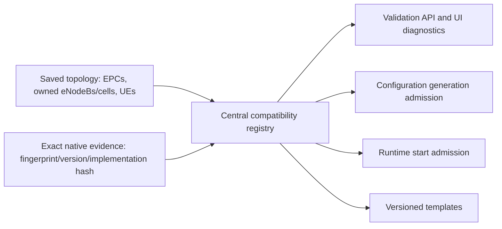
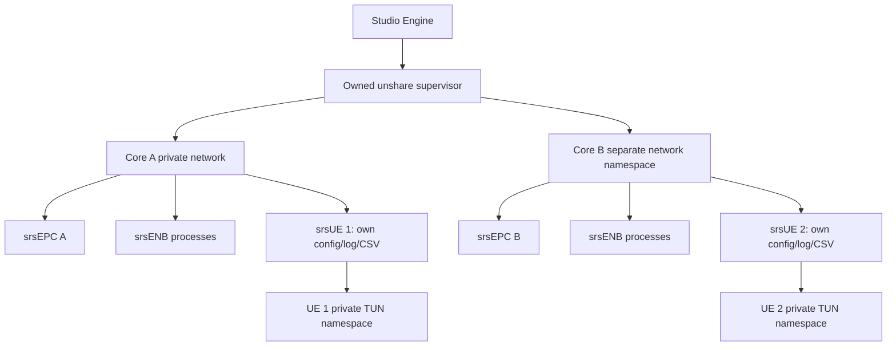
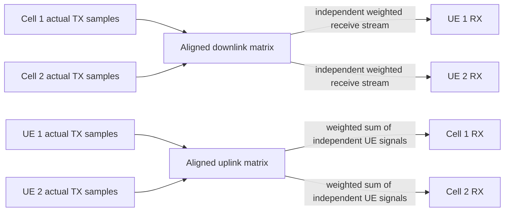
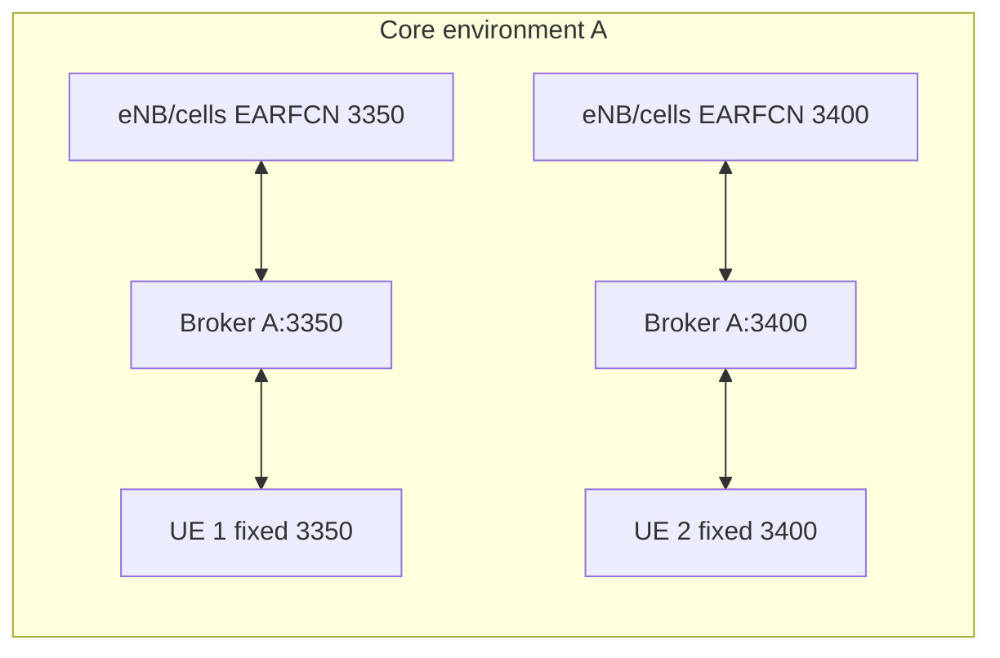
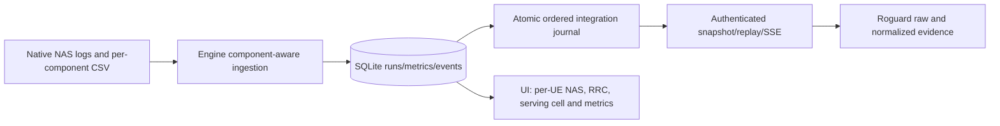

# Advanced network architecture

Implementation boundary: preserve the legacy direct/co-channel adapter; add `matrix-iq-v2` as an explicit, bounded extension. Diagrams describe the implemented execution and evidence boundaries. Native status comes from the evidence registry, not these drawings.

## Topology and capability admission

Each eNodeB and UE references its core explicitly when more than one exists. A UE selects a fixed EARFCN and a matching logical RF environment. No neighbor observation is manufactured from this assignment.

## Native supervision and isolation

Initial code ceilings are two EPCs, two total UEs, four total cells/eNodeBs, three cells per eNodeB. These are not claims of measured capacity. A native failure fails the whole experiment: retain the failed role identity, stop healthy dependents as stopped, clear current attachment, preserve their historical measurements. Full experiment stop is always available; core-scoped stop uses environment ownership checks.

## RF matrix: one carrier environment

For UE u and cell c use reciprocal amplitude gain `10^(-attenuation[u,c]/20)`. Each source starts at sample index zero; queues retain variable frame boundaries and provide bounded backpressure. Outputs use one millisecond of the environment's sample rate. No live geometry, delay, Doppler or gain timeline is modeled.

## Multiple frequencies (one core, two fixed-frequency UEs)

For the separate two-core profile, the native-supervision diagram above applies: one EPC/eNodeB/UE chain in each of two separate core network namespaces. These diagrams represent alternative profiles, not three simultaneous UEs.

There is no signal edge between different carrier brokers or independent core environments. Multi-frequency means independent fixed-frequency receivers, not inter-frequency scanning or retuning. Mixed bandwidth on one carrier is rejected. Different carriers can have separate transport/sample rates. Open5GS selection is a prerequisite boundary until isolated provisioning/readiness/attach are actually implemented and verified; existing external cores are never adopted or stopped.

## Evidence

Keep legacy scalar fields as the first UE compatibility view, and put multi-component extensions inside the existing v1 `applied_topology` object. Every new metric carries a stable `component_id`. Ground truth remains experiment metadata. NAS attachment and RRC connection are tracked separately; current serving correlation requires fresh evidence and an unambiguous applied match.
